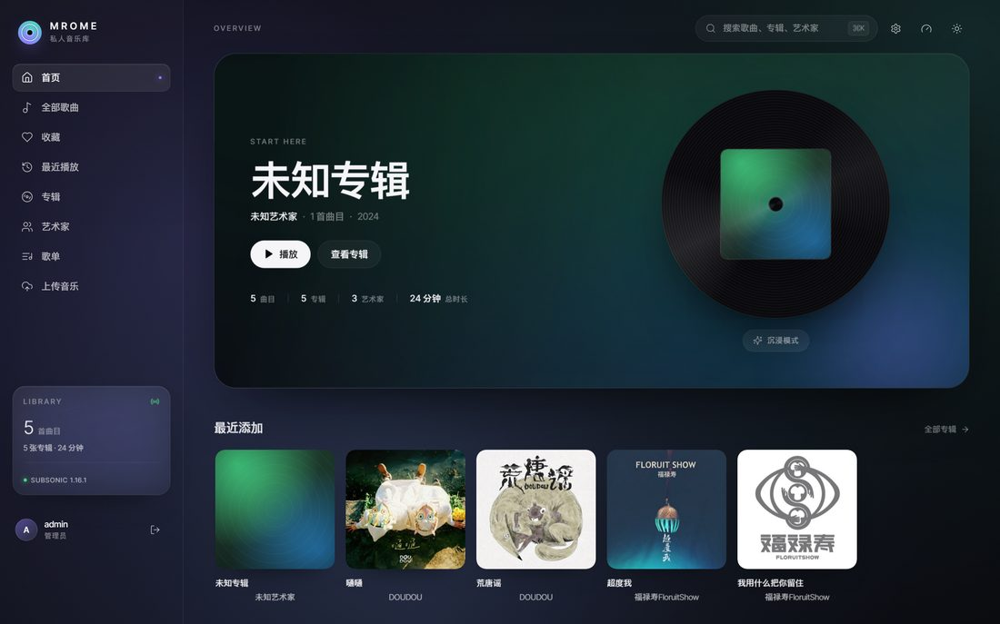
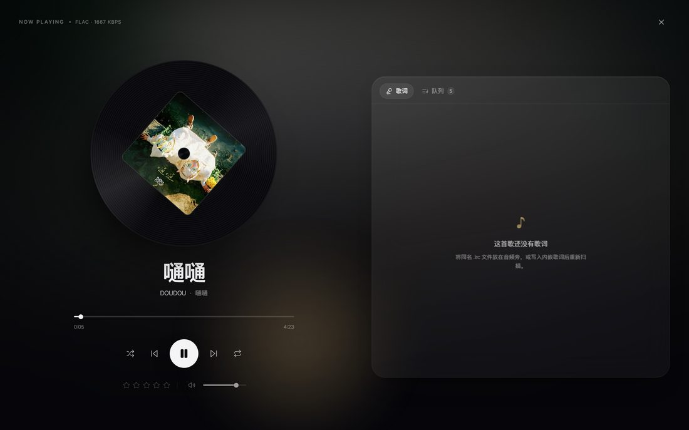
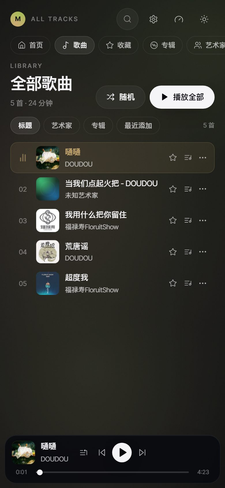
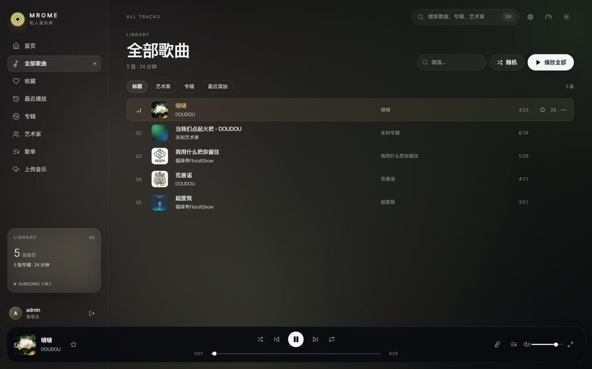
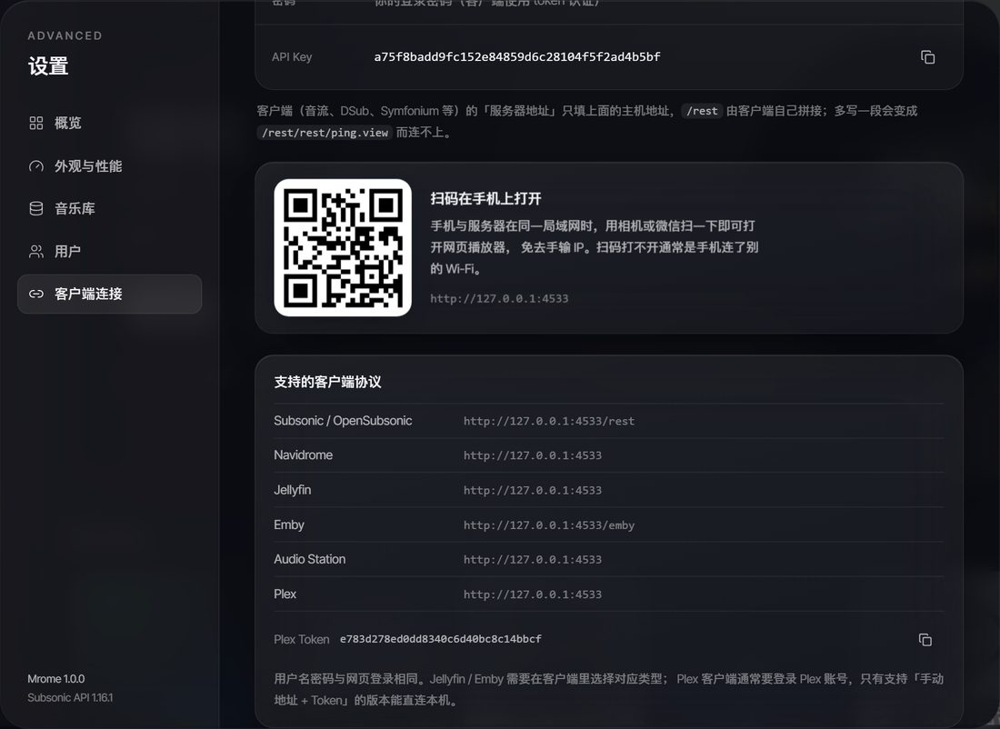

<div align="center">

# Mrome

**自托管的私人音乐库 · 上传即归档 · 一次部署，六种客户端协议**

[](https://go.dev)
[](https://svelte.dev)
[](https://sqlite.org)
[](https://subsonic.org)
[](https://opensubsonic.netlify.app)

</div>



Mrome 是一个**单二进制**的私人音乐服务：把歌丢进目录（或拖进网页），自动解析标签与封面，网页端是一个玻璃质感的沉浸式播放器；同时对外提供 **Subsonic / Navidrome / Jellyfin / Emby / Audio Station / Plex** 六套协议，音流、DSub、Symfonium 这类客户端可以直接连。

收藏、评分、播放次数写在同一张表里，**网页和所有客户端看到的是同一份数据**。

```
┌──────────────────────────────────────────────────────────────────────────┐
│  浏览器 (Svelte 5 SPA)      Subsonic / Navidrome / Jellyfin / Emby …      │
│  玻璃拟态 + 极光背景         /rest  /auth  /Items  /webapi  /library      │
└───────────────┬──────────────────────────────┬───────────────────────────┘
                │ /api/*  (Cookie Session)     │ 各协议独立认证
                ▼                              ▼
        ┌──────────────────────────────────────────────────┐
        │  Go net/http                                     │
        │  internal/api  subsonic  jellyfin  audiostream   │
        │  ratelimit     navidrome  plex                   │
        └───────────────┬──────────────────────────────────┘
                        ▼
        ┌───────────────────────────────┐      ┌──────────────────┐
        │  store (SQLite, WAL)          │◀────▶│ scanner          │
        │  songs / albums / artists /   │      │ ID3 · Vorbis ·   │
        │  playlists / annotations /    │      │ MP4 标签与封面   │
        │  users / settings             │      │ 时长探测         │
        └───────────────┬───────────────┘      └──────────────────┘
                        ▼
              /music (音频)   /data (db, covers, uploads, trash)
```

---

## 目录

- [截图](#截图)
- [功能](#功能)
- [客户端协议](#客户端协议)
- [快速开始](#快速开始)
- [配置](#配置)
- [项目结构](#项目结构)
- [数据库设计](#数据库设计)
- [Subsonic 端点映射](#subsonic-端点映射)
- [其他协议映射](#其他协议映射)
- [关键实现](#关键实现)
- [前端设计](#前端设计)
- [安全说明](#安全说明)
- [已知限制](#已知限制)
- [测试](#测试)

---

## 截图

| 播放舞台（歌词） | 手机端 |
| --- | --- |
|  |  |

| 全部歌曲 | 客户端连接 |
| --- | --- |
|  |  |

---

## 功能

**音乐库**

- 拖拽 / 文件夹批量上传，4 MB 分片、断点续传、并发 2、失败重试
- 扫描目录并解析 ID3v1/v2、Vorbis Comment、MP4/M4A、FLAC 标签
- 自动提取内嵌封面或同目录 `cover.jpg`，按显示尺寸返回服务端缩放的缩略图（160/320/640/1024，磁盘缓存），前端用 `srcset` 自动选择
- 无标签文件归入「未知艺术家 / 未知专辑」，仍可播放
- 手动编辑元数据（管理员，重新扫描后仍保留）、关键词搜索、按艺术家 / 专辑 / 流派 / 最近添加浏览
- 歌单创建、改名、增删歌曲，与 Subsonic 客户端双向同步
- 收藏页、评分、播放计数、**最近播放**（网页与客户端共用一份记录）
- 定时自动重扫（默认 6 小时），新文件丢进目录无需手动点

**网页播放器**

- 底部常驻玻璃拟态播放条，跨路由不中断；刷新后恢复队列、进度并自动续播
- 旋转黑胶 + 极光背景：从当前封面提取主色，Canvas 驱动流体渐变
- 全屏播放舞台：黑胶、歌词逐行高亮、评分、队列管理、移动端下滑收起
- 三种播放模式（顺序 / 单曲循环 / 随机），切换时上方弹出提示
- 移动端两行布局：封面信息 + 完整控制键 + 可拖动进度条
- LRC 歌词（同名 `.lrc` 或内嵌），点击歌词跳转
- 亮 / 暗双主题；`⌘K` 全局搜索；空格 / ←→ / M / L 快捷键
- Media Session：系统媒体键、锁屏信息与封面

**渲染性能分级**

- 设置里一键切换「完整效果 / 流畅模式 / 静止模式」，选择写入 `localStorage`
- 流畅模式关闭全部逐帧渲染（极光 Canvas、毛玻璃、模糊封面、噪点、循环 keyframe），改为静态配色
- 静止模式在流畅模式之上再冻结黑胶旋转与均衡器，适合远程桌面或极致省电
- `auto` 档按设备能力自动降级：CPU ≤ 4 线程、内存 ≤ 4 GB、系统「减少动态效果」

---

## 客户端协议

一个实例同时对外提供六套协议，账号密码共用，条目 ID 在协议之间一致：

| 协议 | 挂载点 | 客户端填写的地址 |
| --- | --- | --- |
| Subsonic / OpenSubsonic | `/rest/*` | `http://host:4533/rest` |
| Navidrome | `/auth/login`、`/api/*` | `http://host:4533` |
| Jellyfin | `/System/*`、`/Users/*`、`/Items`、`/Audio/*` | `http://host:4533` |
| Emby | `/emby/*` | `http://host:4533/emby` |
| Audio Station（群晖） | `/webapi/*` | `http://host:4533` |
| Plex（只读，见限制） | `/identity`、`/library/*` | `http://host:4533` + Token |

- Navidrome / Jellyfin / Emby / Audio Station 的令牌都是同一套 HS256 JWT（密钥来自实例 `settings.secret`），只用标准库实现
- 客户端的收藏、播放结束上报会写回 `annotations`，与网页共用一张表
- 设置 → 客户端连接 页给出每种协议该填的地址、Plex Token，以及一个指向本站的二维码（手机扫码直接打开）

> 注意：客户端的「服务器地址」只填主机地址，`/rest` 由客户端自己拼接。多写一段会变成 `/rest/rest/ping.view` 而连不上。

---

## 快速开始

### Docker（推荐）

```bash
git clone https://github.com/jiqing112/mroom.git
cd mroom
docker compose up -d
```

打开 `http://localhost:4533`。首次启动会在库中创建管理员（默认 `admin / admin`，**请立刻修改**）。

### 二进制

从 Release 下载对应平台的 `mrome`，或自行编译：

```bash
go build -o mrome ./cmd/mrome
cd web && npm install && npm run build && cd ..
./mrome            # 必须在仓库根目录启动（配置里是相对路径）
```

`web/dist` 由 Go 直接以 `http.FileServer` 读取，改前端只需 `npm run build`，不必重启进程。

### 环境变量优先于配置文件

```bash
MROME_DATA_DIR=/var/lib/mrome \
MROME_MUSIC_DIR=/srv/music \
MROME_WEB_DIR=/opt/mrome/web/dist \
./mrome
```

### 生成演示曲库（可选）

```bash
python scripts/make_demo_library.py   # 合成带 ID3 与封面的音频
python scripts/make_demo_lyrics.py    # 按真实时长生成 .lrc
```

---

## 配置

启动时按顺序读取：内置默认值 → `config.yaml` → `.env` → 真实环境变量，后者覆盖前者。配置文件只解析顶层 `键: 值`。

| YAML 键 | 环境变量 | 默认值 | 说明 |
| --- | --- | --- | --- |
| `addr` | `MROME_ADDR` | `:4533` | 监听地址 |
| `music_dir` | `MROME_MUSIC_DIR` | `./data/music` | 音乐目录 |
| `data_dir` | `MROME_DATA_DIR` | `./data` | 数据根目录 |
| `db` | `MROME_DB` | `<data>/mrome.db` | SQLite 路径 |
| `covers_dir` | `MROME_COVERS_DIR` | `<data>/covers` | 封面缓存 |
| `uploads_dir` | `MROME_UPLOADS_DIR` | `<data>/uploads` | 分片暂存 |
| `web_dir` | `MROME_WEB_DIR` | `./web/dist` | 前端产物 |
| `admin_user` | `MROME_ADMIN_USER` | `admin` | 初始管理员 |
| `admin_password` | `MROME_ADMIN_PASSWORD` | `admin` | 初始密码 |
| `max_upload_mb` | `MROME_MAX_UPLOAD_MB` | `512` | 单文件上限 |
| `scan_on_start` | `MROME_SCAN_ON_START` | `true` | 启动时扫描 |
| `scan_interval_hours` | `MROME_SCAN_INTERVAL_HOURS` | `6` | 定时重扫间隔，`0` 关闭 |

**免登录访客模式**：可在「设置 → 用户 → 免登录访问」一键开关，也可让 `admin_user` 与 `admin_password` 任意一项留空来默认开启。设置里的选择写入数据库（`settings.guest_mode`）并优先于配置文件，关闭时会立即作废已签发的访客会话；若库中还没有管理员，关闭会被拒绝，以免把实例锁死。访客可浏览、搜索、播放、收藏、管理歌单，上传、扫描、用户管理与设置仍需管理员。

---

## 项目结构

```
.
├── cmd/mrome/main.go              # 启动、路由挂载、优雅退出
├── internal/
│   ├── config/                    # 环境变量 / YAML 配置
│   ├── util/                      # 稳定 MD5 ID、随机串、JWT、客户端 IP
│   ├── store/                     # SQLite：schema、查询、写路径
│   │   ├── db.go                  # 打开 / 迁移 / 统计 / 设置
│   │   ├── models.go              # Song / Album / Artist / Playlist
│   │   ├── library.go             # 扫描写入、浏览、搜索、标注、最近播放
│   │   ├── playlists.go           # 歌单与条目顺序
│   │   └── users.go               # bcrypt + AES-GCM 密码保险箱
│   ├── media/probe.go             # MP3/FLAC/OGG/WAV/AIFF/AAC/WMA/MP4 时长与码率
│   ├── scanner/scanner.go         # 目录遍历、标签解析、封面落盘
│   ├── ratelimit/ratelimit.go     # 登录失败计数与锁定（内存态）
│   ├── api/                       # 网页端 REST（Cookie Session）
│   │   ├── api.go                 # 路由、会话签名、中间件、免登录开关
│   │   ├── library.go             # 浏览 / 搜索 / 最近播放 / 封面 / 音频流
│   │   ├── cover.go               # 封面缩略图缩放与磁盘缓存
│   │   ├── actions.go             # 歌单 / 收藏 / 评分 / scrobble
│   │   ├── upload.go              # 分片上传与断点续传
│   │   ├── ndcompat.go            # Navidrome 登录 / playqueue / scrobble
│   │   └── admin.go               # 扫描、用户、设置、SPA 托管
│   ├── subsonic/                  # Subsonic 1.16.1（JSON / XML / JSONP）
│   ├── jellyfin/                  # Jellyfin + Emby（/emby 前缀复用）
│   ├── audiostream/               # 群晖 Audio Station（/webapi）
│   └── plex/                      # Plex 只读 XML 接口
├── web/                           # Svelte 5 + Vite + Tailwind 4
│   ├── src/lib/                   # api / router / player / colors / lyrics / perf
│   ├── src/components/            # 播放条、舞台、设置、搜索、卡片、评分
│   └── src/pages/                 # 登录、首页、歌曲、收藏、最近播放、专辑、艺术家、歌单、上传
├── scripts/                       # 演示曲库与歌词生成
├── Dockerfile · docker-compose.yml · Makefile
└── data/  (运行时生成：mrome.db、covers/、uploads/、trash/)
```

---

## 数据库设计

单文件 SQLite（WAL 模式），启动时自动建表。

| 表 | 作用 | 关键点 |
| --- | --- | --- |
| `artists` / `albums` / `songs` | 音乐库主体 | `songs.album_id`、`songs.artist_id` 关联；`path` 唯一 |
| `annotations` | 收藏 / 评分 / 播放次数 / 播放时间 | `(user_id, item_id)` 聚合，避免为每种关系建表 |
| `playlists` / `playlist_songs` | 歌单 | `position` 保证顺序 |
| `users` | 账号 | `bcrypt` 存密码，另存 AES-GCM 加密副本供 Subsonic token 认证 |
| `settings` | 实例配置 | `secret`、`guest_mode`、`guest_user_id` |

- **单一事实来源**：专辑统计在扫描结束后统一 `RefreshAlbumStats()` 重算
- **播放时间统一为秒**：写入时把毫秒输入归一化，避免新旧记录排序错乱
- **未知标签**：缺失字段兜底为「未知艺术家 / 未知专辑」，保证任何文件都能被索引

---

## Subsonic 端点映射

统一入口 `internal/subsonic.Handler.ServeHTTP`：剥离 `/rest/` 与 `.view` → 认证 → 分发 → 组装信封（`status`、`version`、`type`、`serverVersion`、`openSubsonic`）→ 按 `f=json|xml` 序列化。

| 端点 | 业务逻辑 |
| --- | --- |
| `ping` / `getLicense` | 空信封 / `license.valid=true` |
| `getMusicFolders` | 固定单库 `id=1` |
| `getArtists` / `getIndexes` | 按首字母分组索引（非 A–Z → `#`） |
| `getArtist` / `getAlbum` / `getSong` | 艺术家+专辑 / 专辑+曲目 / 单曲 |
| `getAlbumList2` | `newest` / `recent` / `frequent` / `random` / `alphabetical*` / `byYear` / `byGenre` / `starred` |
| `search2/3` | 子串匹配（不做 Lucene），标题 / 艺术家 / 专辑 |
| `star` / `unstar` / `setRating` / `scrobble` | 写入 `annotations`，播放时间上卷到专辑 |
| `getPlaylists` / `getPlaylist` / `createPlaylist` / `updatePlaylist` / `deletePlaylist` | 歌单增删改查 |
| `stream` / `download` | `http.ServeContent` → 自动处理 Range、`If-Range`、HEAD、`206` |
| `getCoverArt` | 依次按专辑 → 歌曲所属专辑 → 艺术家首张封面解析 |
| `getLyricsBySongId` / `getLyrics` | 解析 LRC 为 `{start, value}` 行（OpenSubsonic） |
| `getScanStatus` / `startScan` | 读取 / 触发扫描器（仅管理员） |
| 视频 / jukebox / 聊天 | 返回错误码 `70`（数据未找到） |

认证支持 `u+t+s`（`md5(password+salt)`）、`u+p` 明文、`p=enc:hex`、OpenSubsonic `apiKey`；`/rest/*` 开启 CORS。

---

## 其他协议映射

**Navidrome**（`internal/api/ndcompat.go`）

| 端点 | 说明 |
| --- | --- |
| `POST /auth/login` | 返回 `id/username/name/isAdmin/token/subsonicSalt/subsonicToken`；token 为 JWT，salt+token 供客户端继续走 Subsonic `t/s` |
| `POST /auth/logout` | 空成功 |
| `GET /api/keepalive` | 200，避免客户端判定断线 |
| `GET/POST /api/playqueue` | 队列由浏览器持有，读返回空队列、写接受并忽略 |
| `POST /api/scrobble` | `submission=true` 时写入播放记录 |

**Jellyfin / Emby**（`internal/jellyfin`，同一实现，Emby 只是 `/emby` 前缀）

| 端点 | 说明 |
| --- | --- |
| `GET /System/Info/Public` | 服务器信息，`Id` 由实例密钥派生且稳定 |
| `POST /Users/AuthenticateByName` | 用户名密码 → `AccessToken`（JWT）+ `User` |
| `GET /Items` | `IncludeItemTypes=Audio/MusicAlbum/MusicArtist` 分流，支持 `SearchTerm`、`Filters=IsFavorite`、`ParentId`、`Limit/StartIndex` |
| `GET /Items/{id}` | 单曲 / 专辑 / 艺术家 |
| `GET /Items/{id}/Images/Primary` | 封面（专辑 → 所属专辑 → 艺术家依次回退） |
| `GET /Audio/{id}/stream` | 原始音频，支持 Range |
| `POST /Sessions/Playing*` | `Stopped` 且播放超过 30 秒时写 scrobble |
| `POST/DELETE /UserFavoriteItems/{id}` | 映射到 `annotations.starred` |

认证接受 `X-Emby-Token`、`X-MediaBrowser-Token`、`api_key` 查询参数与 `Authorization: MediaBrowser Token="…"`。

**Audio Station**（`internal/audiostream`）

`/webapi/query.cgi` 返回 API 表；`auth.cgi` 登录发 `sid`（JWT）；`AudioStation/{song,album,artist,genre,playlist,search}.cgi` 提供列表；`stream.cgi` / `cover.cgi` 提供媒体。响应统一为 `{success, data|error}`。

**Plex**（`internal/plex`，只读 XML）

`/identity`、`/library/sections`、`/library/sections/1/all?type=8|9|10`、`/library/metadata/{id}[/children|/thumb]`、`/library/parts/{id}/file.ext`、`/photo/:/transcode`。Token 由实例密钥派生（设置页可见），请求需带 `X-Plex-Token`。

---

## 关键实现

**元数据与时长**：标签用 `dhowden/tag`，时长与码率由 `internal/media/probe.go` 自行解析帧头（MP3 逐帧、FLAC STREAMINFO、OGG/OPUS 页、MP4 `mvhd`、WAV/AIFF 头），不依赖 ffmpeg。

**扫描**：遍历音乐目录 → 读取标签与内嵌封面 → 以 `path` 为键 upsert → 汇总专辑统计。删除的文件在下次扫描时从库中移除（磁盘文件不动）。支持定时重扫，`Start()` 自带并发保护。

**分片上传**：`init` 创建会话 → `PUT /api/upload/{id}` 带 `Content-Range` 写分片 → `complete` 合并并触发扫描。中断后可查询已收分片续传。

**封面主色 → 极光**：前端把封面画到 8×8 Canvas 采样，聚类出主色，写入 CSS 变量 `--accent` / `--accent-2`，极光 Canvas 用这两色做流体渐变。

**媒体服务**：所有音频出口统一走 `http.ServeContent`，Range / `206` / `If-Range` / HEAD 由标准库处理；封面按尺寸缩放后落盘缓存。

---

## 前端设计

- **Svelte 5 runes**：`$state` / `$derived` / `$effect`，播放器状态集中在 `lib/player.svelte.js`，跨路由不中断
- **无运行时依赖**：构建产物只有 HTML + 一个 JS + 一个 CSS，字体本地托管
- **玻璃拟态**：`backdrop-filter` 只在完整效果模式启用；源码里不手写 `-webkit-` 前缀，交给构建工具，否则 Lightning CSS 会丢标准属性
- **性能分级**：`lib/perf.svelte.js` 是唯一状态源，通过 `<html data-perf>` 让 CSS 一次性关闭所有逐帧重绘
- **移动端**：≤860px 时播放条改为两行（信息 + 完整控制 + 可拖进度），侧栏收成顶部胶囊导航

---

## 安全说明

- 上传接口仅管理员可用，校验扩展名与大小，落盘前做绝对路径前缀检查
- 网页端使用 HMAC-SHA256 签名、HttpOnly、SameSite=Lax 的会话 Cookie（30 天）；修改密码会立即使此前签发的会话失效
- 密码用 bcrypt 存储；为兼容 Subsonic token 认证，另存一份由实例密钥 AES-GCM 加密的密码副本（`users.password_enc`），密钥在首次启动时随机生成于 `settings` 表
- 登录失败按客户端 IP 计数：网页与 Navidrome 登录连续 8 次、Subsonic 认证连续 12 次失败后锁定 5 分钟（内存态，重启清零）
- `/rest/*` 开放 CORS（`*`），符合 Subsonic 客户端生态；如需收紧可在反向代理层限制来源
- 删除歌曲时音频文件进入 `/data/trash` 而非直接销毁
- 生产部署建议置于 HTTPS 反向代理之后，并立即修改默认管理员密码

---

## 已知限制

- **不做转码**：`format` / `maxBitRate` 被忽略，始终返回原始文件。FLAC 客户端若强制要求 MP3 可能无法播放，建议客户端设为「原始格式」
- **搜索为子串匹配**：不实现 Lucene 语法，`search3` 仅按标题 / 艺术家 / 专辑模糊匹配
- **单用户库语义**：所有用户共享同一音乐库；歌单有 `public` 标记，非公开歌单仅所有者与管理员可见
- **歌词**：读取同名 `.lrc` 或内嵌歌词，不接入在线歌词源
- **扫描为全量**：每次扫描遍历整个目录，万级以内体验良好；不做文件系统监听
- **Plex 只支持「手动地址 + Token」**：Plex 客户端通常要先通过 plex.tv 云账号认证再连本地服务器，自建服务端无法冒充该流程
- **客户端协议为只读**：Jellyfin / Emby / Audio Station / Plex 提供浏览、封面、播放与收藏回写，不提供客户端侧的上传、删除、元数据编辑

---

## 测试

```bash
go test ./...        # 存储、媒体探测、封面与 Subsonic 辅助函数
go vet ./...
cd web && npm run build
```

---

<div align="center">
<sub>Built with Go + Svelte 5 + SQLite · 单二进制 · 无外部依赖</sub>
</div>
